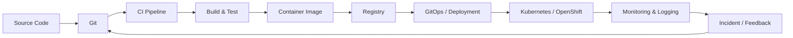

<!-- ===================== HERO ===================== -->

  

  <b>AWS · Kubernetes · OpenShift · Terraform · Ansible · CI/CD · GitOps · Linux · Observability</b>

  DevOps / Cloud Engineer with nearly <b>6 years of continuous commercial IT experience</b>,
  including <b>3+ years in DevOps and cloud engineering</b> and an earlier foundation in
  customer-facing technical support.

  
  
  
  
  

---

# 👋 About Me

I am a **DevOps / Cloud Engineer** with nearly 6 years of commercial IT experience.

My career started in customer-facing technical support, where I developed strong troubleshooting, incident-handling, escalation, documentation, Linux, networking, and database fundamentals.

I then moved into **DevOps and cloud engineering**, working with AWS and multi-cloud environments, Infrastructure as Code, container orchestration, CI/CD, GitOps, monitoring, logging, and deployment automation.

My current focus is:

**DevOps Engineering · Cloud Infrastructure · Platform Engineering · SRE**

---

# 💼 Commercial Experience

## RedCloud Soft Solutions Pvt Ltd
### AWS DevOps Engineer
**Mar 2023 – May 2026**

Commercial DevOps and cloud engineering experience across AWS and multi-cloud environments.

Key areas of work:

- AWS cloud infrastructure design and deployment
- Terraform-based Infrastructure as Code
- Kubernetes and OpenShift administration
- Docker and Podman containerization
- CI/CD pipeline automation
- Jenkins, GitLab CI/CD, and Azure DevOps
- Argo CD and GitOps-based delivery
- Ansible configuration management
- Helm-based Kubernetes deployments
- Prometheus and Grafana monitoring
- ELK-based centralized logging
- Linux administration and Shell/Python automation
- High-availability, deployment, and operational troubleshooting

### AWS Infrastructure

Hands-on work with services including:

`EC2` `S3` `RDS` `EFS` `IAM` `VPC` `Route 53` `CloudFront` `ELB` `CloudWatch` `Lambda` `SNS` `SQS` `API Gateway` `DynamoDB`

### Container & Platform Engineering

Worked with:

`Kubernetes` `OpenShift` `Docker` `Podman` `Helm` `NGINX Ingress`

including cluster provisioning, workload deployment, application lifecycle management, traffic routing, and deployment strategies.

### CI/CD & GitOps

Worked with:

`Jenkins` `GitLab CI/CD` `Azure DevOps` `GitHub Actions` `Argo CD`

including automated builds, deployment pipelines, GitOps workflows, release automation, and application delivery.

---

## Pantech ProEd Pvt Ltd
### Technical Project Engineer / Technical Support
**Aug 2020 – Feb 2023**

Built my technical foundation through customer-facing support across Linux, applications, databases, networking, and configuration issues.

Key responsibilities included:

- customer-facing technical troubleshooting
- Linux and application diagnostics
- TCP/IP, DNS, HTTP/HTTPS, and SSL/TLS troubleshooting
- PostgreSQL investigation
- logs and command-line diagnostics
- incident reproduction and escalation
- configuration changes and validation
- runbooks, troubleshooting guides, and knowledge-base documentation
- technical guidance and team support

This support background continues to strengthen my DevOps work by keeping troubleshooting, customer impact, incident ownership, and clear technical communication at the center of how I operate systems.

---

# 🧰 Core Technology Stack

| Area | Technologies |
|---|---|
| **Cloud** | AWS, GCP, Azure |
| **Infrastructure as Code** | Terraform, OpenTofu |
| **Configuration Management** | Ansible |
| **Containers** | Docker, Podman |
| **Orchestration** | Kubernetes, OpenShift |
| **Package / Deployment Management** | Helm |
| **CI/CD** | Jenkins, GitLab CI/CD, Azure DevOps, GitHub Actions |
| **GitOps** | Argo CD |
| **Operating Systems** | Linux, RHEL, Ubuntu, Windows |
| **Web / Application Servers** | Nginx, Tomcat |
| **Monitoring** | Prometheus, Grafana, CloudWatch |
| **Logging** | ELK, Elasticsearch, Logstash, Kibana, Splunk |
| **Scripting** | Bash / Shell, Python |
| **Version Control** | Git, GitHub, GitLab |
| **Databases** | PostgreSQL, Amazon RDS, DynamoDB, Oracle Database 19c |
| **Networking** | VPC, DNS, Route 53, Load Balancing, NGINX Ingress, TCP/IP |
| **Code Quality** | SonarQube |

  

---

# ⚙️ DevOps Engineering Workflow

  <b>Automate → Deploy → Observe → Troubleshoot → Improve</b>

---

# ☁️ Featured Cloud & DevOps Projects

> These repositories are independent engineering labs created to demonstrate technical capabilities. They do not contain employer or client source code, infrastructure, credentials, or production data.

<table>
<tr>
<td width="50%" valign="top">

## 🚦 OpsPilot

**AWS · Terraform · ECS · RDS · Redis · CI/CD · Observability**

- AWS staging environment
- Infrastructure as Code
- ECS Fargate
- RDS and Redis
- GitHub Actions
- AWS OIDC
- SLOs and error budgets
- metrics, logs, and traces
- deployment and dependency recovery workflows

</td>
<td width="50%" valign="top">

## 🔄 GitOps ArgoCD DevOps Lab

**Kubernetes · Argo CD · GitOps · CI/CD**

- Kubernetes deployments
- GitOps delivery
- Argo CD synchronization
- drift detection
- rollback workflows
- GitHub Actions integration
- declarative application delivery

</td>
</tr>

<tr>
<td width="50%" valign="top">

## 🐧 Linux DevOps Operations Lab

**Linux · Ansible · Docker · Nginx · PostgreSQL · Monitoring**

- multi-VM Linux environment
- Ansible configuration management
- Docker workloads
- Nginx configuration
- infrastructure monitoring
- access management
- deployment rollback
- operational troubleshooting

</td>
<td width="50%" valign="top">

## 🖥️ Ubuntu / KVM Infrastructure Lab

**KVM · QEMU · libvirt · OpenTofu · Prometheus**

- KVM/QEMU virtualization
- libvirt networking
- Infrastructure as Code
- Linux VM provisioning
- monitoring and alerting
- storage and network incident simulation

</td>
</tr>

<tr>
<td width="50%" valign="top">

## 🛠️ Linux Infrastructure Support Toolkit

**Linux · Bash · Ansible · PostgreSQL · systemd · LVM · nftables**

- Linux diagnostics
- systemd troubleshooting
- DNS investigation
- LVM and filesystem management
- firewall troubleshooting
- PostgreSQL recovery
- idempotent Ansible baseline
- support-bundle automation

</td>
<td width="50%" valign="top">

## 🌙 NIGHTWATCH Operations Lab

**Linux · Nginx · PostgreSQL · Redis · RabbitMQ · Observability**

- production-style incident investigation
- queue and worker troubleshooting
- PostgreSQL locks and connection exhaustion
- Redis dependency analysis
- Nginx and HTTP failure isolation
- metrics, logs, and traces

</td>
</tr>
</table>

---

# 📊 Engineering Highlights

<table>
<tr>
<td width="33%" align="center">

### AWS Infrastructure
Hands-on commercial experience with compute, networking, storage, databases, IAM, load balancing, DNS, serverless, and monitoring.

</td>

<td width="33%" align="center">

### Kubernetes & OpenShift
Cluster and workload operations, Helm, ingress, container deployment, scaling, and release workflows.

</td>

<td width="33%" align="center">

### Infrastructure as Code
Terraform and Ansible for repeatable infrastructure provisioning and configuration management.

</td>
</tr>

<tr>
<td width="33%" align="center">

### CI/CD
Jenkins, GitLab CI/CD, Azure DevOps, GitHub Actions, automated deployment workflows.

</td>

<td width="33%" align="center">

### GitOps
Argo CD, declarative deployments, synchronization, rollback, and configuration drift handling.

</td>

<td width="33%" align="center">

### Observability
Prometheus, Grafana, CloudWatch, ELK, Splunk, logs, metrics, alerting, and incident investigation.

</td>
</tr>
</table>

---

# 🔧 What I Bring to DevOps

My earlier technical-support experience gives me an additional operational perspective.

I do not approach infrastructure only as deployment automation.

I also think about:

- customer and application impact
- failure isolation
- logs and evidence
- safe remediation
- rollback
- incident communication
- post-change validation
- documentation
- recurring-problem prevention

That combination of **support engineering + DevOps engineering** is especially useful in Cloud Infrastructure, Platform Engineering, SRE, and production-facing DevOps environments.

---

# 🎯 Current Direction

  <b>DevOps Engineering · Cloud Infrastructure · Platform Engineering · SRE</b>

  Building reliable, repeatable, observable infrastructure with
  <b>automation, Infrastructure as Code, containers, CI/CD, GitOps, and operational discipline.</b>

---

# 📫 Connect

  

  

  

  <b>Open to DevOps, Cloud Infrastructure, Platform Engineering, SRE, and Cloud Support opportunities.</b>

 

  

